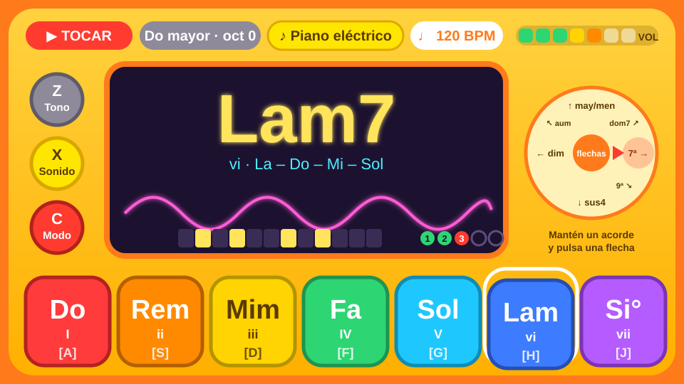

# Chispa 🎹⚡ (nombre provisional)

Sintetizador para niños, escrito en Rust, para Linux. Se toca con el teclado del ordenador
y una perilla, y su interfaz de colores vivos está inspirada en el
[HiChord](https://updater.hichord.shop/manual/) y en el M-VAVE FM-1.

Con él se puede:

- Tocar **acordes que siempre suenan bien** con 7 teclas y cambiarles el "color" con las flechas.
- Elegir entre muchos **sonidos** (analógico, FM, samples) y **efectos** (eco, distorsión, robot…).
- Hacer **ritmos** y **arpegios** con el tempo controlado por la perilla.
- Grabar capas en un **looper de 6 pistas**.
- Grabar su voz y **destrozar samples** en el taller.
- **Guardar** canciones y **exportarlas a MP3, OGG o WAV**.

## Estado

📝 **Fase de diseño.** Todavía no hay código.

- [Investigación](docs/investigacion.md): qué hacen el HiChord y el FM-1, la perilla de AliExpress y las crates de Rust.
- [Plan](docs/plan.md): principios, mapa de teclas, funciones, arquitectura, fases y preguntas abiertas.
- [Mando](docs/mando.md): mapeo del macropad de 12 teclas y 4 perillas.
- [Bocetos](docs/bocetos/README.md): todas las pantallas.
