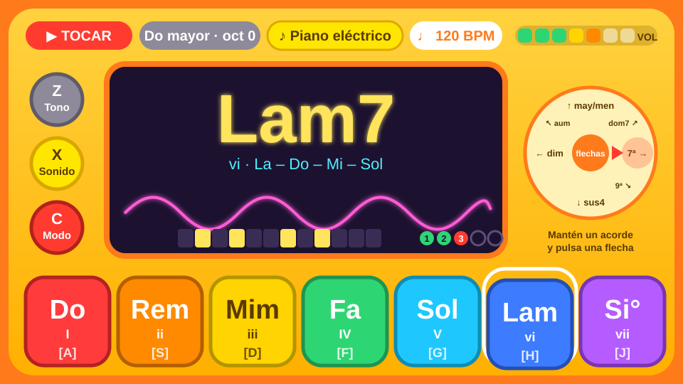
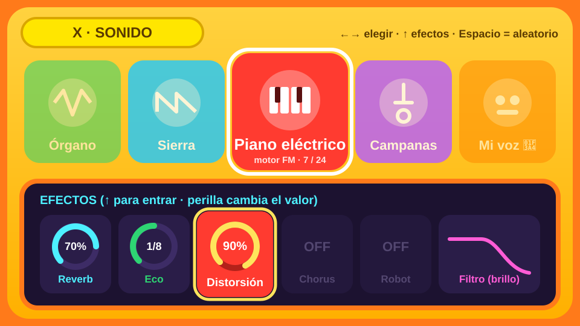
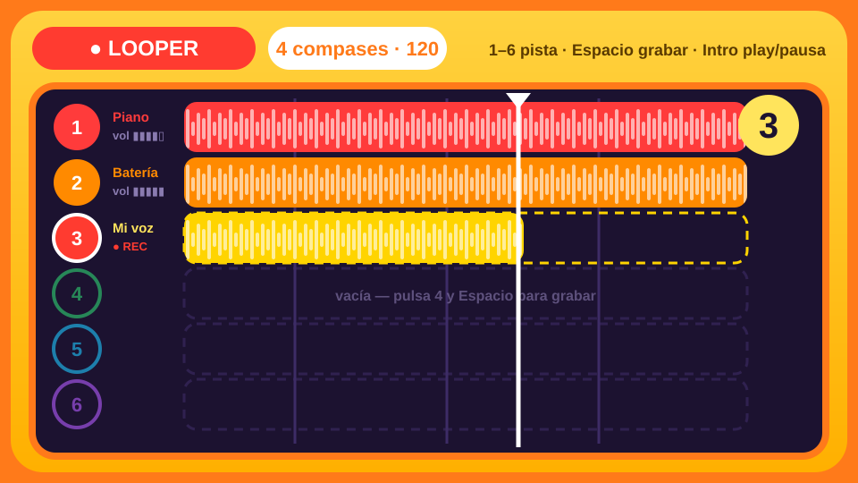
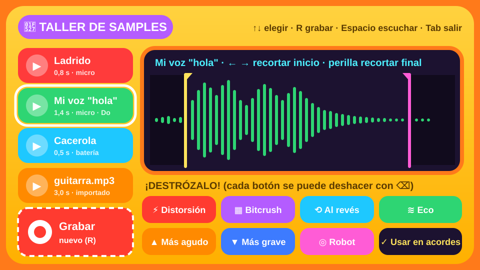
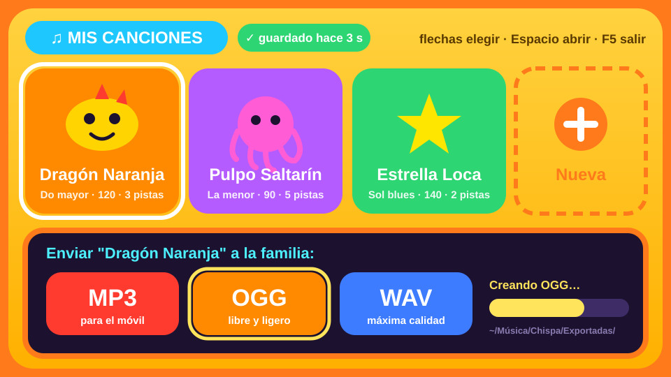
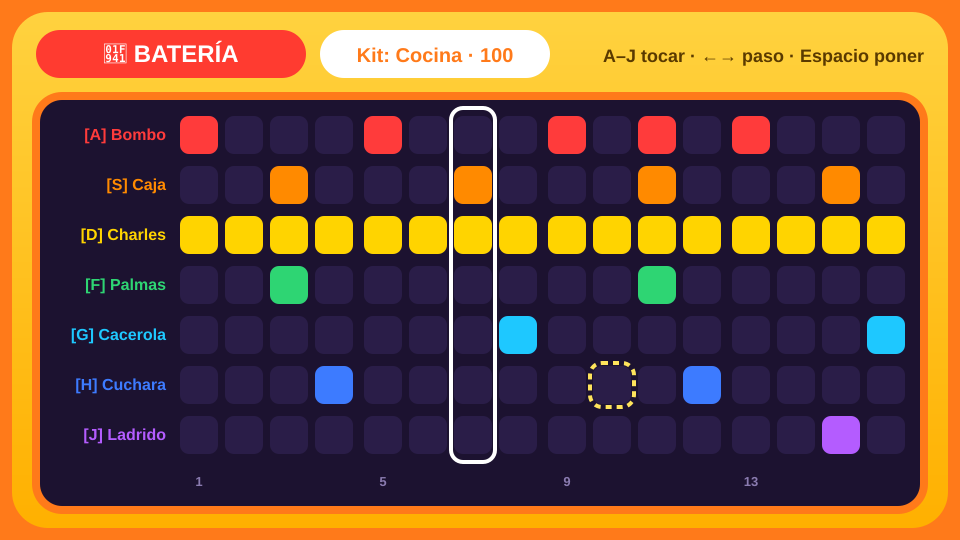
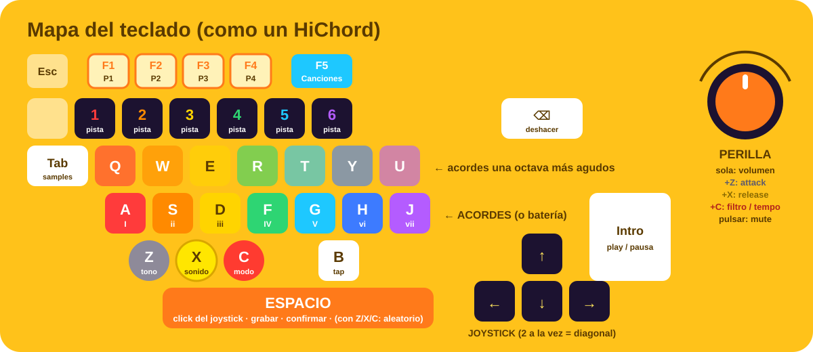

# Bocetos de la interfaz

Pantallas con colores vivos al estilo HiChord: carcasa amarilla y naranja, pantalla central
oscura tipo OLED con texto neón, y un color fijo para cada acorde.
Son bocetos (SVG); la versión final se dibujará con `egui` y mantendrá esta paleta.

## Pantalla principal (modo Tocar)
Los 7 acordes de colores (A–J), los 3 menús del HiChord (Z gris, X amarillo, C rojo),
la rueda de flechas (joystick) que cambia el color del acorde, el osciloscopio, las notas
en el mini piano y el estado del looper.

## Menú amarillo: sonidos y efectos
Carrusel de sonidos con ←/→. Efectos con interruptor y anillo que muestra el valor de la perilla.

## Looper de 6 pistas
La pista 1 marca la duración y las demás se sincronizan. Grabación con Espacio.

## Taller de samples
Biblioteca, recorte con flechas y perilla, y botones para "destrozar" el sonido.

## Mis canciones: guardar y exportar
Autoguardado, tarjetas con nombres divertidos y exportación a MP3, OGG o WAV con un botón.

## Batería y secuenciador de 16 pasos

## Mapa del teclado y la perilla

