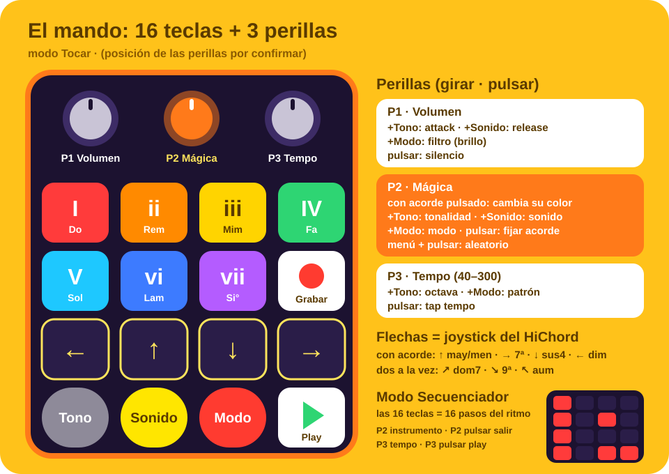

# El mando: macropad de 16 teclas y 3 perillas

**Modelo elegido:** [teclado macro de 16 teclas y 3 perillas (AliExpress)](https://es.aliexpress.com/item/1005010043319280.html)

- 16 teclas en rejilla 4×4 y 3 perillas. Cada perilla tiene 3 acciones: girar a la izquierda,
  girar a la derecha y pulsar.
- 3 capas con indicador LED, RGB, base de silicona antideslizante.
- Cable USB-C, Bluetooth y 2,4 GHz. En inalámbrico apaga las luces.
- El fabricante lo configura con un programa de Windows y la configuración queda guardada en el
  teclado. **No tenemos Windows**, así que lo haremos desde Linux (ver
  [Configuración sin Windows](#configuración-sin-windows)).
- Un comprador lo usa en Photoshop con las perillas para zoom y tamaño de pincel. Eso confirma
  que las perillas pueden mandar cualquier tecla, no solo el volumen.

**Por qué este y no el de 12 teclas y 4 perillas:** con 16 teclas caben las 4 flechas del
joystick (como el HiChord de verdad) y además el **secuenciador de 16 pasos se toca directamente**,
una tecla por paso. La cuarta perilla no hace falta, porque el filtro pasa a "volumen + botón rojo",
que es como lo hace el HiChord.



> La posición exacta de las perillas se confirmará cuando llegue. El boceto las pone arriba.

---

## Mapeo en modo Tocar

### Teclas

| | 1 | 2 | 3 | 4 |
|---|---|---|---|---|
| **Fila 1** | Acorde **I** (rojo) | Acorde **ii** (naranja) | Acorde **iii** (amarillo) | Acorde **IV** (verde) |
| **Fila 2** | Acorde **V** (cian) | Acorde **vi** (azul) | Acorde **vii** (morado) | ● **Grabar** |
| **Fila 3** | **←** | **↑** | **↓** | **→** |
| **Fila 4** | **Tono** (gris) | **Sonido** (amarillo) | **Modo** (rojo) | ▶ **Play / pausa** |

- **Flechas = joystick del HiChord.** Si las pulsas mientras mantienes un acorde, cambian su color:
  ↑ mayor/menor · → 7ª · ↓ sus4 · ← disminuido. Dos flechas a la vez dan las diagonales:
  ↗ 7ª dominante · ↘ 9ª · ↖ aumentado.
- **Menús:** si mantienes Tono, Sonido o Modo, las flechas hacen lo mismo que en el HiChord.
  - Tono: ←/→ tonalidad, ↑/↓ octava.
  - Sonido: ←/→ sonido, ↑ efectos.
  - Modo: ←/→ modo, ↑ BPM.
- **Grabar:** arma o graba la pista actual del looper. Mientras mantienes Grabar, los acordes I–vi
  (las 6 primeras teclas) eligen la pista 1–6.
- En **modo Batería**, las 7 teclas de acorde tocan los 7 golpes del kit.

### Perillas

Igual que en el HiChord: **si mantienes un botón de menú, la perilla cambia algo de ese menú.**

| Perilla | Girar | + Tono | + Sonido | + Modo | Pulsar |
|---|---|---|---|---|---|
| **P1 · Volumen** | Volumen | Attack | Release | **Filtro** (brillo) | Silencio |
| **P2 · Mágica** | Con un acorde pulsado: va pasando por sus colores. Si no, navega | Tonalidad | Sonido | Modo | Con acorde: **fijarlo** (chord lock). Con menú: 🎲 aleatorio |
| **P3 · Tempo** | BPM (40–300) | Octava | Cantidad de efecto | Patrón de arpegio o ritmo | Tap tempo |

Orden de colores con P2: normal → mayor/menor → 7ª → 7ª dominante → 9ª → sus4 → disminuido →
aumentado → (vuelta a normal). Sirve para que los más pequeños, a los que les cuesta combinar
flechas, también puedan cambiar el color.

---

## Mapeo en modo Secuenciador (batería)

Las **16 teclas son los 16 pasos del ritmo**: pulsas y el paso se enciende o se apaga.
La pantalla muestra la rejilla y la fila del instrumento elegido.

| Control | Función |
|---|---|
| Teclas 1–16 | Encender o apagar el paso |
| P2 girar | Elegir instrumento (bombo, caja, charles…) |
| P2 pulsar | Salir del secuenciador. El patrón se graba solo en una pista libre del looper |
| P3 girar | Tempo |
| P3 pulsar | Play / pausa |
| P1 | Volumen, como siempre |

---

## Capas del mando

Los modos los gestiona la app, así que **las 3 capas se programan iguales**: si el niño cambia de
capa sin querer, no pasa nada. Más adelante se podrían usar la capa 2 para el looper y la capa 3
para el taller de samples.

---

## Configuración sin Windows

La app lee el mando por su cuenta (ver abajo), así que **solo necesita que cada tecla y cada
acción de perilla mande un código distinto**: 16 + 9 = 25 códigos. Puede que no haga falta
configurar nada.

### Paso 1: ver qué manda de fábrica (al llegar)

Conectarlo **por cable** y ejecutar:

```bash
lsusb                 # anotar el ID, p. ej. 1189:8890
sudo dnf install evtest
sudo evtest           # elegir el mando y pulsar cada tecla y girar/pulsar cada perilla
```

- **Si los 25 códigos son distintos:** no hay que configurar nada. La app los aprende con el
  asistente "Aprender mando". **Hecho.**
- **Si se repiten** (por ejemplo, las 3 perillas mandan volumen): seguir al paso 2.

Ojo: un mando puede aparecer como **varios dispositivos** en `evtest`, normalmente uno para el
teclado y otro para las teclas multimedia. La app los abrirá todos.

### Paso 2: programarlo desde Linux con `ch57x-keyboard-tool`

[`ch57x-keyboard-tool`](https://github.com/kriomant/ch57x-keyboard-tool) es un programa de línea
de comandos en Rust que programa estos mandos chinos con chip CH57x, que es casi seguro el de este.

- **IDs admitidos:** `1189:8890`, `1189:8840` y `1189:8842`. Si `lsusb` da uno de estos, es muy
  probable que funcione.
- **Modelos probados:** 3×4, 3×3, 3×2, 3×1 y 4×1, y en las fotos aparecen 4×3 y 5×3 con 3 perillas.
  El de 4×4 con 3 perillas **no está en la lista**, pero si el ID coincide lo normal es que sí funcione.

```bash
cargo install ch57x-keyboard-tool
ch57x-keyboard-tool show-keys            # nombres de tecla admitidos (¿hay F13–F24?)
ch57x-keyboard-tool validate < config/mando.yaml
sudo ch57x-keyboard-tool upload < config/mando.yaml
```

El fichero `config/mando.yaml` se preparará cuando sepamos el ID y los nombres de tecla
que admite. La configuración se guarda en el mando y no hay que repetirla.

### Paso 3 (plan B): Windows en una máquina virtual

Solo si el paso 2 no funciona:
- Instalar `virt-manager` (está en Fedora) y la **ISO de evaluación gratuita de Windows** de Microsoft.
- Pasar el USB del mando a la máquina virtual y usar allí el programa del fabricante, una sola vez.
- Después se borra la máquina virtual.

También vale pedir prestado un PC con Windows durante 10 minutos.

### Códigos propuestos

Sin modificadores, para que cada acción sea un solo evento:

| Control | Código propuesto |
|---|---|
| Teclas 1–12 | `F13` … `F24` |
| Teclas 13–16 | Teclado numérico `1` `2` `3` `4` |
| P1 izquierda / derecha / pulsar | Num `5` / `6` / `7` |
| P2 izquierda / derecha / pulsar | Num `8` / `9` / `0` |
| P3 izquierda / derecha / pulsar | Num `/` / `*` / `-` |

Si la herramienta no admite F13–F24, vale **cualquier** combinación de 25 teclas distintas
(letras incluidas). El asistente de la app las aprende igual.

---

## Cómo lo lee la app

1. **`evdev` + acceso exclusivo (`EVIOCGRAB`).** La app abre el mando directamente. Mientras está
   abierta, sus pulsaciones no llegan al escritorio, así que no escriben en otras ventanas ni
   cambian el volumen del sistema.
2. **Se identifica por dispositivo**, así que no importa si sus códigos coinciden con teclas del
   teclado normal: los dos funcionan a la vez sin pisarse.
3. **Asistente "Aprender mando"** (la primera vez o desde el modo papá). La pantalla pide
   *"pulsa la tecla roja"*, *"gira la perilla 1 a la derecha"*… y guarda el resultado en
   `mando.ron`. Si un código se repite, avisa.
4. **Permisos:** una regla `udev` para leerlo sin `sudo`. Los ID se sacan con `lsusb`:
   ```
   # /etc/udev/rules.d/70-chispa-mando.rules
   SUBSYSTEM=="input", ATTRS{idVendor}=="XXXX", ATTRS{idProduct}=="YYYY", MODE="0660", TAG+="uaccess"
   ```
5. Si se desconecta el mando, la app sigue funcionando con el teclado normal y lo vuelve a coger
   solo cuando se reconecta.

## Recomendaciones

- **Usarlo por cable.** Tiene menos latencia, no gasta batería y las luces siguen encendidas.
- **Teclas de colores.** Si las teclas son estándar (MX), poner teclas o pegatinas iguales a la
  pantalla: arcoíris en los acordes, negro con flecha amarilla en las flechas, gris/amarillo/rojo
  en los menús y blanco en Grabar y Play.
- **RGB:** si permite color fijo, ponerlo suave o apagado para que no compita con las teclas de colores.
