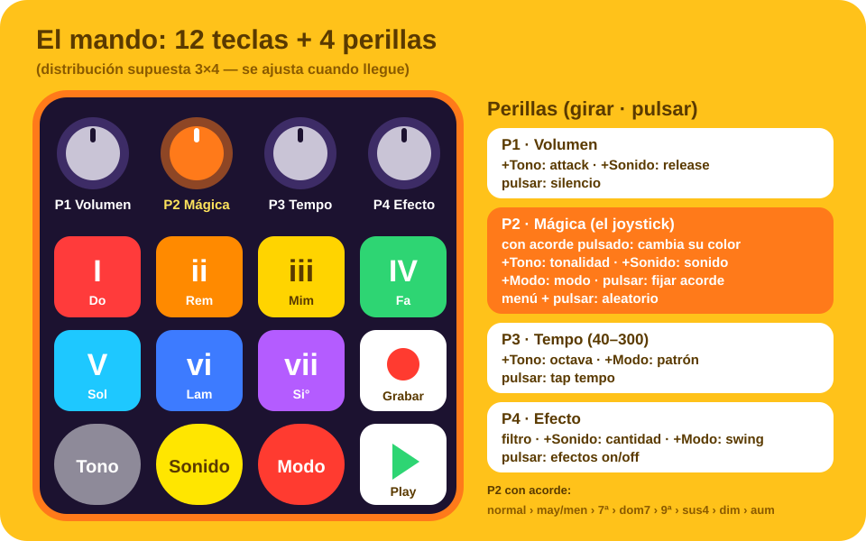

# El mando: macropad de 12 teclas y 4 perillas

Modelo elegido (AliExpress): teclado mecánico de **12 teclas y 4 perillas**. Cada perilla tiene
3 acciones (girar a la izquierda, girar a la derecha y pulsar). Tiene **3 capas** con LED, RGB,
interruptores *hot-swap*, USB-C, Bluetooth 5.0 y 2,4 GHz según el modelo.

Con 12 teclas y 4 perillas se puede hacer casi todo el HiChord **sin el teclado del ordenador**.
El teclado normal sigue funcionando para "modo papá" y para las cosas avanzadas.



> La distribución exacta (3×4 o 4×3, posición de las perillas) se confirmará cuando llegue.
> El boceto supone 3 filas de 4 teclas con las perillas arriba.

---

## Mapeo

### Teclas

| Fila | Tecla 1 | Tecla 2 | Tecla 3 | Tecla 4 |
|---|---|---|---|---|
| 1 | Acorde **I** (rojo) | Acorde **ii** (naranja) | Acorde **iii** (amarillo) | Acorde **IV** (verde) |
| 2 | Acorde **V** (cian) | Acorde **vi** (azul) | Acorde **vii** (morado) | ● **Grabar** (looper) |
| 3 | **Tono** (gris) | **Sonido** (amarillo) | **Modo** (rojo) | ▶ **Play / pausa** |

En modo Batería, las 7 teclas de acorde tocan los 7 golpes del kit.

### Perillas

La regla general es la misma que en el HiChord: **si mantienes un botón de menú, la perilla
cambia lo de ese menú.**

| Perilla | Girar | Girar + **Tono** | Girar + **Sonido** | Girar + **Modo** | Pulsar |
|---|---|---|---|---|---|
| **P1 · Volumen** | Volumen | Attack | Release | — | Silencio |
| **P2 · Mágica** (el joystick) | Con un acorde pulsado: cambia su **color**. Si no: navega | Tonalidad | Sonido | Modo | Con acorde: **fijarlo** (chord lock). Con menú: 🎲 aleatorio |
| **P3 · Tempo** | BPM (40–300) | Octava | — | Patrón de arpegio o ritmo | Tap tempo |
| **P4 · Efecto** | Filtro (brillo) | — | Cantidad del efecto elegido | Swing | Efectos on/off |

**Colores del acorde con P2.** Mientras se mantiene un acorde, cada "clic" de la perilla pasa al
siguiente color, en este orden:

normal → mayor/menor → 7ª → 7ª dominante → 9ª → sus4 → disminuido → aumentado → (vuelta a normal)

Es más fácil para un niño que las 8 direcciones del joystick, y en la pantalla se ve una rueda
que va girando (boceto principal, a la derecha). Con el teclado del ordenador se siguen pudiendo
usar las flechas.

### Capas

El mando tiene 3 capas, pero **los modos los gestiona la app**, no el mando. Propuesta: programar
las 3 capas iguales, para que si el niño cambia de capa sin querer no pase nada.
Alternativa para más adelante: capa 2 = looper (teclas 1–6 = pistas) y capa 3 = taller de samples.

---

## Cómo lo lee la app

1. **`evdev` + acceso exclusivo (`EVIOCGRAB`).** La app abre el mando como dispositivo de
   entrada propio. Mientras está abierta, sus pulsaciones no llegan al escritorio, así que no
   cambian el volumen del sistema ni escriben letras en otras ventanas.
2. **Como sabemos de qué dispositivo viene cada evento, no importa qué teclas envíe.** Basta con
   que las 12 teclas y las 12 acciones de perilla manden **24 códigos distintos**. No hace falta
   reprogramarlo a F13–F24.
3. **Asistente "Aprender mando"** (primera vez o modo papá). La pantalla va pidiendo: *"pulsa la
   tecla roja"*, *"gira la perilla 1 a la derecha"*… y guarda el resultado en `mando.ron`. Si un
   código se repite, avisa.
4. **Permisos:** una regla `udev` para que tu usuario pueda leer el mando sin `sudo`.
   Ejemplo (los ID se rellenan con `lsusb`):
   ```
   # /etc/udev/rules.d/70-chispa-mando.rules
   SUBSYSTEM=="input", ATTRS{idVendor}=="1189", ATTRS{idProduct}=="8890", MODE="0660", TAG+="uaccess"
   ```
5. **Si los códigos de fábrica se repiten** (por ejemplo, varias perillas mandan volumen),
   hay que reprogramarlo una vez:
   - En Linux con [`ch57x-keyboard-tool`](https://docs.rs/crate/ch57x-keyboard-tool), una
     herramienta en Rust para estos mandos con chip CH57x. Admite varios modelos de 3×4 y 4×3 con
     2–3 perillas. El de 4 perillas **no aparece en la lista**, así que hay que comprobar con
     `lsusb` si el ID es `1189:8890`, `1189:8840` u `1189:8842`.
   - Si no, con el programa del fabricante en un Windows, una sola vez. La configuración queda
     guardada en el mando.

## Recomendaciones

- **Usarlo por cable.** Tiene menos latencia, no depende de batería y el RGB sigue encendido
  (en inalámbrico se apaga). Además, el fabricante pide configurarlo primero por cable.
- **Teclas de colores.** Al ser *hot-swap* y con teclas estándar, se pueden poner teclas o pegatinas
  de los 7 colores del arcoíris en los acordes, gris, amarillo y rojo en los menús, y blanco en
  grabar y play, igual que en la pantalla. Así el niño asocia tecla y color al momento.
- **RGB:** si permite color fijo, ponerlo en blanco suave o apagado para que no compita con
  las teclas de colores.
