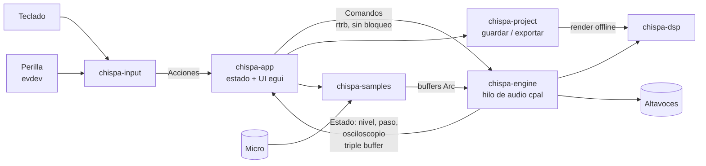

# Plan: **Chispa**, un sintetizador para niños en Rust

> "Chispa" es un nombre provisional. Se puede cambiar.

Inspirado en el [HiChord](https://updater.hichord.shop/manual/) (interfaz y forma de tocar) y en el
[M-VAVE FM-1](https://synthanatomy.com/2026/07/m-vave-fm-1-review-low-budget-pocket-fm-ynthesizer-with-iconic-sounds.html)
(motor FM, secuenciador y efectos). La investigación completa está en [investigacion.md](investigacion.md)
y los bocetos en [bocetos/](bocetos/README.md).

---

## 1. Principios de diseño

1. **Todo suena bien.** Las 7 teclas de acorde siempre tocan dentro de la tonalidad. No hay
   notas "malas", igual que en el HiChord.
2. **Nada se rompe.** No hay botón de "borrar" a la primera: borrar o salir exige *mantener*
   la tecla 1,5 s, con una barra que se va llenando. Existe *deshacer* (`Retroceso`).
   Todo se guarda solo.
3. **Colores vivos y grandes.** Carcasa amarilla y naranja, pantalla central oscura tipo OLED
   con texto neón, y un color fijo para cada acorde (arcoíris). Letra redondeada y muy grande.
4. **Pocas teclas, mucho juego.** Mismo esquema de 3 menús (gris, amarillo, rojo) que el HiChord.
   Las cosas avanzadas quedan en un "modo papá" protegido.
5. **Oídos a salvo.** Limitador final obligatorio y volumen máximo configurable
   (por defecto −12 dBFS). Sin picos aunque se sumen 6 pistas con distorsión.
6. **Sin conexión.** No usa internet, no tiene anuncios ni cuentas.
7. **Pantalla completa (modo kiosco).** Arranca a pantalla completa y solo se sale con
   la combinación de "modo papá".

---

## 2. Control con el teclado

> **Mando principal elegido:** [macropad de 16 teclas y 3 perillas](https://es.aliexpress.com/item/1005010043319280.html).
> Su mapeo completo está en [mando.md](mando.md) ([boceto](bocetos/mando-16-teclas.svg)). Con él se toca casi todo
> sin el teclado del ordenador. El mapa de abajo es para el teclado normal, que sigue funcionando
> a la vez.

El teclado imita los controles del HiChord. Ver el boceto
[mapa-teclado.svg](bocetos/mapa-teclado.svg).

| Tecla(s) | HiChord | Función en Chispa |
|---|---|---|
| `A S D F G H J` | Botones 1–7 | Tocar los acordes I–vii (en modo batería: 7 golpes) |
| `Q W E R T Y U` | (extra) | Los mismos acordes una octava más aguda. En modo Lead, las notas de la escala |
| Flechas (combinadas = diagonales) | Joystick | Mientras mantienes un acorde, cambian su color: ↑ mayor/menor, → 7ª, ↓ sus4, ← dim, ↗ dom7, ↘ 9ª, ↖ aum. En menús, navegan |
| `Espacio` | Click del joystick | Armar/grabar el looper, confirmar en menús |
| `Z` | Botón **gris** | Tonalidad y ajustes (con ←/→ tonalidad, ↑/↓ octava) |
| `X` | Botón **amarillo** | Sonidos y efectos (←/→ sonido, ↑ efectos) |
| `C` | Botón **rojo** | Modos y tempo (←/→ modo, ↑ BPM) |
| `Z`/`X`/`C` + `Espacio` | Menú + click | 🎲 Aleatorio para ese menú |
| `1`–`6` | Pistas del looper | Seleccionar pista (mantener = borrarla) |
| `Intro` | Transporte | Play / pausa de todo |
| `Tab` | — | Abrir el **Taller de samples** |
| `F1`–`F4` | P1–P4 | Cargar preset (mantener = guardar) |
| `F5` | — | Pantalla de **Canciones** (guardar y exportar) |
| `B` | Tap tempo | Pulsar 3 o más veces para marcar el tempo |
| `Retroceso` | — | Deshacer |
| `Ctrl+Alt+P` | — | Modo papá (ajustes avanzados, salir) |

### La perilla

Igual que la rueda del HiChord:

| Acción | Efecto |
|---|---|
| Girar | Volumen |
| Girar con `Z` (gris) pulsada | Attack (cuánto tarda en sonar) |
| Girar con `X` (amarillo) pulsada | Release (cuánto tarda en apagarse) |
| Girar con `C` (rojo) pulsada | Filtro (brillo), o **tempo** si el menú BPM está abierto |
| Girar en un menú | Cambiar el valor seleccionado |
| Pulsar la perilla | Mute / confirmar |

Si compráis un modelo con **3 perillas**, quedan fijas: 1 volumen, 2 tempo, 3 filtro/efecto.

Todo el mapeo vive en un fichero `teclas.ron` editable, así cualquier teclado sirve.

---

## 3. Funciones

### 3.1 Tocar (núcleo HiChord)
- 12 tonalidades y escalas: mayor, menor, pentatónica mayor/menor, blues, dórica, mixolidia,
  armónica, japonesa (in-sen) y árabe (hijaz).
- Modificadores con flechas en 3 modos: *Básico*, *Jazz* (extendidos) y *Prestados*.
- Inversiones automáticas con *voice leading*.
- Bajo opcional (nota raíz una octava abajo).
- Modos de toque: **Tocar**, **Rasgueo**, **Melodía** (una nota), **Zumbido** (drone),
  **Arpegio** (6 patrones), **Repetir**, **Secuencia** (16 pasos), **Batería**, **Ritmos**.

### 3.2 Sonidos (≈24 de serie)
Hay 5 motores de sonido:
- **Analógico virtual**: sierra, cuadrada, pulso con PWM, supersaw. Para pads, leads y bajos.
- **FM de 2 y 4 operadores** (idea del FM-1): piano eléctrico, campanas, marimba, bajo FM.
- **Sampler**: piano, guitarra, voces, y **los samples del niño** (su voz, el perro, una cacerola…).
- **Wavetable sencillo**: órgano, "robot", coro.
- **Ruido**: viento, olas, nave espacial.

Cada sonido es un fichero `.ron` (preset). En el modo papá se pueden crear más.

### 3.3 Efectos
Reverb (3 salas), Delay sincronizado, Chorus, Flanger, Phaser, **Distorsión** (suave, fuzz,
bitcrush), Tape (wow/flutter), Tremolo, Vibrato y Filtro (LP/HP/BP, controlado con la perilla).
Hay un **limitador** fijo al final de la cadena.

### 3.4 Batería y ritmos
- 7 kits (acústico, electrónico, 8-bit, juguetes, cocina, animales, cuerpo) y 56 ritmos (7 estilos × 8).
- Secuenciador de 16 pasos con rejilla de colores. Se pueden grabar los golpes en vivo.

### 3.5 Looper (6 pistas)
- La pista 1 marca la duración (libre o 1–8 compases) y las pistas 2–6 se sincronizan.
- Cuantización al compás para que siempre "cuadre".
- Al salir del secuenciador o de los ritmos, el patrón se graba solo en una pista libre.
- Mezclador: volumen y mute por pista.

### 3.6 Taller de samples (gestión y distorsión)
- **Biblioteca**: lista de tarjetas grandes con el color y la forma de onda de cada sample.
- **Grabar con el micro** (hasta 10 s), con detección de tono y transposición a Do.
- **Importar** WAV/MP3/OGG/FLAC desde una carpeta vigilada (`~/Música/Chispa/Importar`),
  sin diálogos de ficheros.
- **Editar**: recortar el inicio y el final con flechas o perilla, normalizar y fundidos.
- **Destrozar** (cada efecto es un botón grande y se puede deshacer):
  Distorsión · Bitcrush · Al revés · Más agudo · Más grave · Robot · Eco · Tartamudeo · Lento/Rápido.
- **Usar** el sample como instrumento (se toca con los acordes) o como golpe de batería.

### 3.7 Canciones: guardar y exportar
- Guardado automático cada 10 s y al cambiar de pantalla.
- Cada canción recibe un nombre divertido generado solo ("Dragón Naranja", "Pulpo Saltarín") y
  un color. Se puede renombrar en el modo papá.
- **Exportar** a **OGG**, **MP3** o **WAV** con un solo botón. El resultado va a
  `~/Música/Chispa/Exportadas/`. Se renderiza más rápido que el tiempo real.
- 4 presets rápidos (F1–F4), como P1–P4 del HiChord.

### 3.8 Extras (si da tiempo)
- **Aleatorio** (🎲) en cada menú.
- **Juego de oído**: suena un acorde y hay que adivinar qué tecla es.
- **Juego de ritmo** al estilo "Chord Hiro".
- **Osciloscopio** animado en la pantalla central.
- Entrada/salida **MIDI** (`midir`).

---

## 4. Arquitectura

Workspace de Cargo con crates pequeños y testeables:

```
chispa/
├── crates/
│   ├── chispa-theory/   # escalas, acordes, modificadores, voice leading (sin audio, 100% tests)
│   ├── chispa-dsp/      # osciladores, FM, sampler, filtros, envolventes, efectos, limitador
│   ├── chispa-engine/   # voces, mezclador, reloj/tempo, arp, secuenciador, looper, hilo de audio
│   ├── chispa-samples/  # biblioteca, importación (symphonia), micro, edición y "destrozar"
│   ├── chispa-project/  # modelo de canción, guardado (serde/ron), render offline y export WAV/OGG/MP3
│   ├── chispa-input/    # teclado + perilla (evdev) → Acciones; mapa configurable
│   └── chispa-app/      # UI (eframe/egui), pantallas, estado, modo kiosco
├── assets/              # samples de serie, presets de sonidos, kits, ritmos, fuentes
└── docs/
```



### Reglas del hilo de audio
- **Nada de bloqueos, reservas de memoria ni E/S** en el callback de `cpal`.
- La UI manda `Command`s (nota on/off, cambio de parámetro, cargar sample…) por un ring buffer
  `rtrb` de un solo productor y un solo consumidor.
- Los samples se cargan fuera del hilo de audio y se pasan como `Arc<[f32]>`. Lo que se libera
  vuelve a la UI para soltarlo allí.
- El motor es **determinista**: la misma canción con los mismos eventos produce el mismo audio.
  Así el export es un render offline del mismo motor, más rápido que el tiempo real,
  y el audio exportado es idéntico al que se oyó.
- El looper reserva memoria al arrancar: 6 pistas × 30 s × 48 kHz × estéreo ≈ 70 MB.

### Formato de proyecto (`.chispa`, carpeta)
```
Dragón Naranja/
├── cancion.ron      # tonalidad, tempo, sonido, efectos, patrones, presets, mezcla
├── pistas/1.wav … 6.wav   # audio del looper
└── samples/         # copias de los samples usados (la canción es autocontenida)
```

---

## 5. Fases y entregables

Cada fase termina con algo que el niño ya puede tocar.

| Fase | Contenido | Resultado jugable |
|---|---|---|
| **0. Esqueleto** | Workspace, `cpal`, ventana `egui` a pantalla completa, `A` toca un seno | "¡Suena!" |
| **1. Acordes** | `chispa-theory`, 7 acordes, flechas como modificadores, 1 sinte analógico con ADSR, pantalla principal | Tocar acordes de colores |
| **2. Menús y mando** | Menús gris/amarillo/rojo, tonalidades, octava, `evdev` con el mando de 16 teclas y 3 perillas, asistente "Aprender mando", volumen, tempo y filtro | Cambiar tono y sonido con la perilla |
| **3. Sonidos** | Motores FM, wavetable, ruido y sampler básico, 24 presets | Muchos instrumentos |
| **4. Tempo y modos** | Reloj, tap tempo, Rasgueo, Arpegio, Repetir, Zumbido, Melodía | Música que se mueve sola |
| **5. Efectos** | Cadena de efectos y limitador | Distorsión, eco… |
| **6. Batería** | Kits, ritmos y secuenciador de 16 pasos | Hacer ritmos |
| **7. Looper** | 6 pistas, sincronía, mezclador y auto-grabado de patrones | Componer capas |
| **8. Taller de samples** | Micro, importación, edición y destrozar | Su propia voz como instrumento |
| **9. Canciones** | Autoguardado, proyectos, export WAV/OGG/MP3 | Guardar y compartir con la familia |
| **10. Pulido** | Aleatorio, juegos, animaciones, modo kiosco y arranque automático, paquete `.rpm` / Flatpak | Producto terminado |

Orden de prioridad si hay que recortar: 0 → 1 → 2 → 4 → 6 → 7 → 9 → 3 → 5 → 8 → 10.

### Calidad
- Tests unitarios en `chispa-theory` (cada acorde y modificador) y en `chispa-dsp`
  (sin NaN, sin clipping después del limitador, estabilidad de filtros).
- Tests *golden* de render: un proyecto de ejemplo se renderiza y se compara su hash/espectro.
- `cargo clippy -D warnings` y `cargo fmt` en CI (GitHub Actions).
- Latencia objetivo: < 10 ms (buffer de 256 muestras a 48 kHz con PipeWire).

---

## 6. Paleta de colores

| Uso | Color | Hex |
|---|---|---|
| Carcasa principal | Amarillo HiChord | `#FFC21A` |
| Carcasa secundaria / bordes | Naranja | `#FF7A1A` |
| Pantalla "OLED" | Morado muy oscuro | `#1C1230` |
| Texto neón en pantalla | Amarillo claro / cian | `#FFE45C` / `#4DF0FF` |
| Menú gris (tonalidad) | Gris cálido | `#8E8A99` |
| Menú amarillo (sonido) | Amarillo limón | `#FFE600` |
| Menú rojo (modo) | Rojo tomate | `#FF3B30` |
| Acorde I | Rojo | `#FF3B3B` |
| Acorde II | Naranja | `#FF8A00` |
| Acorde III | Amarillo | `#FFD400` |
| Acorde IV | Verde | `#2ED573` |
| Acorde V | Cian | `#1EC8FF` |
| Acorde VI | Azul | `#3D7BFF` |
| Acorde VII | Morado | `#B45CFF` |

Fuente: **Fredoka** (OFL, redondeada y muy legible), incluida en el binario.

---

## 7. Preguntas abiertas

1. **¿Cuántos años tiene tu hijo?** En el mensaje faltaba la edad. Con menos de 6 años conviene
   usar iconos en lugar de texto y quitar los nombres de los acordes. Con 8 o más se pueden
   enseñar nombres de acordes y notas. El plan admite las dos cosas con un ajuste de "nivel".
2. ~~¿Qué teclado vais a comprar?~~ Resuelto: macropad de 16 teclas y 3 perillas, ver [mando.md](mando.md).
   Cuando llegue, hay que mirar su `lsusb` y los códigos que envía de fábrica.
3. **¿En qué ordenador va a correr?** Si es un equipo antiguo o una Raspberry Pi, bajo la
   polifonía y la calidad de la reverb.
4. **¿Nombre definitivo?** "Chispa" es provisional.
5. **¿Samples de serie?** Propongo grabar o usar samples con licencia libre (CC0) para no tener
   problemas de derechos.
